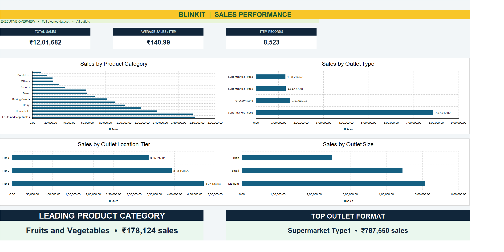

# 🛒 BlinkIT Grocery Sales Analysis | Excel Dashboard

## 📌 Project Overview

This project analyzes BlinkIT grocery sales data using Microsoft Excel to identify sales trends, product performance, customer preferences, and outlet-level business insights.

The project demonstrates practical skills in data cleaning, exploratory analysis, KPI reporting, PivotTables, and dashboard development.

## 📊 Dashboard Preview

## 🎯 Project Objectives

- Analyze overall sales performance
- Identify top-performing product categories
- Compare sales across outlet locations and sizes
- Understand customer ratings and product preferences
- Build a visually appealing Excel dashboard
- Generate actionable business insights

## 🛠️ Tools & Techniques

| Tool / Technique | Purpose |
|---|---|
| Microsoft Excel | Data analysis and reporting |
| PivotTables | Data summarization |
| PivotCharts | Visualizing sales performance |
| Excel Formulas | Data cleaning and calculations |
| Conditional Formatting | Highlighting performance |
| KPI Cards | Business performance monitoring |
| Dashboard Design | Presenting insights |

## 📈 Key Performance Indicators

The dashboard focuses on:

- **Total Sales:** Overall revenue generated
- **Average Sales:** Average sales value
- **Number of Items:** Total analyzed items
- **Average Rating:** Customer rating performance

## 🔍 Analysis Performed

### 1. Data Cleaning
- Identified missing values
- Checked duplicate records
- Validated sales and product information
- Standardized inconsistent categories
- Prepared data for analysis

### 2. Sales Analysis
- Sales by item type
- Sales by outlet size
- Sales by outlet location
- Sales by fat content
- Sales by outlet establishment year

### 3. Dashboard Development
- Created KPI summary cards
- Developed PivotTables and PivotCharts
- Applied a BlinkIT-inspired visual theme
- Organized charts for business reporting

## 💡 Business Insights

The analysis is designed to help identify:

- High-performing product categories
- Differences in outlet-level sales
- Revenue contribution by outlet size
- Customer preferences across product types
- Opportunities to improve sales performance

## 📁 Project Files

| File | Description |
|---|---|
| BlinkIT_Branded_Dashboard.xlsx | Excel analysis and dashboard |
| BlinkIT_Dashboard.png | Dashboard preview |
| README.md | Project documentation |

## 🚀 How to View the Project

1. Download the Excel workbook from this repository.
2. Open the file in Microsoft Excel.
3. Navigate to the dashboard worksheet.
4. Explore the KPI cards, charts, and insights.
5. Review the supporting analysis sheets.

## 👨‍💻 About the Author

**Gurudev Mishra**

Aspiring Data Analyst | MIS Reporting | Business Intelligence

Skilled in Advanced Excel, SQL, Python, Power BI, and Tableau.

📍 Mumbai, India

🔗 [GitHub Profile](https://github.com/Gurudevmishra)

---

⭐ If you found this project useful, consider starring the repository.

